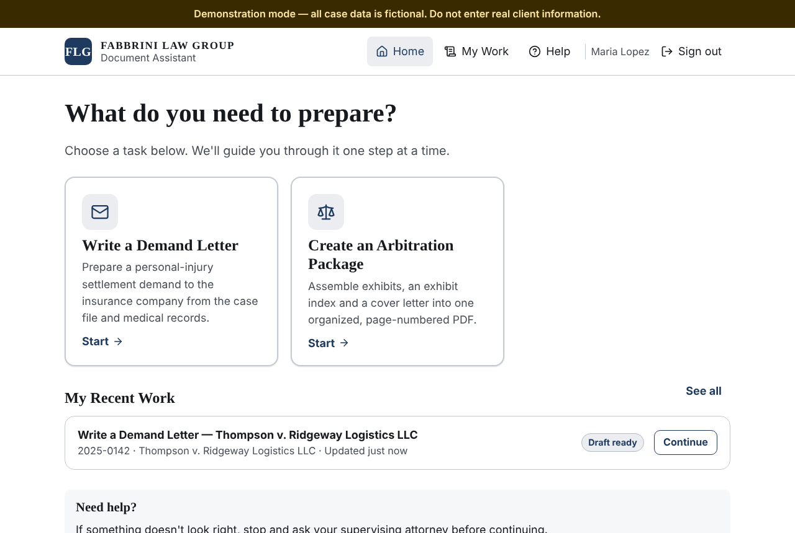

# Fabbrini Law Group — Document Assistant

A private, browser-based assistant that helps staff prepare legal work product — starting with
**personal-injury demand letters** and **arbitration exhibit packages** — while keeping an attorney
in control of everything that leaves the firm.

- **Employees** sign in, pick a task, choose the case, check the information, and get a draft with
  every missing or conflicting item flagged. They never see prompts, AI settings or technical options.
- **Administrators** add employees, choose who can use each skill, build new skills with a guided
  form (no programming), change the look of the home screen, and review all activity.
- **Attorneys** review and approve every draft. Nothing is sent, filed or emailed by the system.



## Where to start

| You want to… | Read |
| --- | --- |
| Understand what's finished, tested, simulated, or still needed | [docs/STATUS.md](docs/STATUS.md) |
| Use the administration screens (owner's guide) | [docs/OWNER-GUIDE.md](docs/OWNER-GUIDE.md) |
| See the actual test results | [docs/TEST-RESULTS.md](docs/TEST-RESULTS.md) |
| Put it on Azure at ai.windycitylawfirm.com | [docs/DEPLOYMENT-AZURE.md](docs/DEPLOYMENT-AZURE.md) |
| Connect Microsoft 365 sign-in (Entra ID) | [docs/ENTRA-SETUP.md](docs/ENTRA-SETUP.md) |
| Connect Clio Manage | [docs/CLIO-SETUP.md](docs/CLIO-SETUP.md) |
| Turn on a real AI provider | [docs/AI-PROVIDER-SETUP.md](docs/AI-PROVIDER-SETUP.md) |
| Review security | [docs/SECURITY-CHECKLIST.md](docs/SECURITY-CHECKLIST.md) |
| Every configuration setting | [docs/ENVIRONMENT.md](docs/ENVIRONMENT.md) |
| How it's built (for a developer) | [docs/ARCHITECTURE.md](docs/ARCHITECTURE.md) |

## Try it on a computer (about 10 minutes)

You need [Node.js 22](https://nodejs.org) installed. Everything else — including the database — is
built in. All data is **fictional**; no Microsoft, Clio or AI account is needed for this demonstration.

```bash
cd document-assistant
npm install        # downloads the components (first time only)
npm run setup      # creates the local database and fictional demonstration data
npm run dev        # starts the app
```

Open <http://localhost:3000> and choose a fictional employee on the sign-in page:

| Sign in as | To see |
| --- | --- |
| **Maria Lopez** (paralegal) | The employee experience with both skills |
| **Daniel Kim** (legal assistant) | An employee who only has the demand-letter skill |
| **Rachel Patel** (associate attorney) | The attorney review queue |
| **Jordan Ellis** (managing attorney) | Everything, including Administration |
| **Taylor Brooks** (IT) | System settings only |

To start over with fresh demonstration data: stop the app, then run `npm run db:reset` and `npm run setup`.

> PDFs match the Word template exactly when LibreOffice is installed on the computer; otherwise a
> built-in PDF renderer is used automatically.

## Run the tests

```bash
npm run typecheck   # TypeScript checks
npm test            # unit and integration tests (86 tests)
npm run test:e2e    # builds the app, then runs the browser acceptance tests (8 tests)
```

## Project layout

```
src/app/            Pages and API routes (Next.js)
src/components/     Screens and interface components
src/lib/            Shared rules: skill configuration, calculations, interface guardrails
src/server/         Server-only code: database, sign-in, permissions, documents, AI, Clio, jobs
drizzle/            Database migrations
tests/              Unit, integration and browser (end-to-end) tests
infra/              Azure infrastructure template (Bicep)
docs/               Documentation
```
