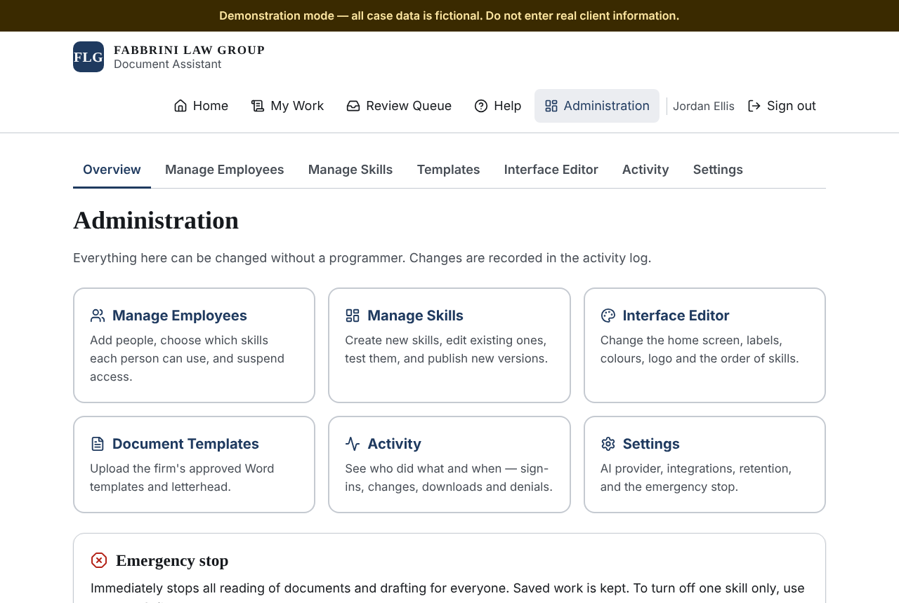
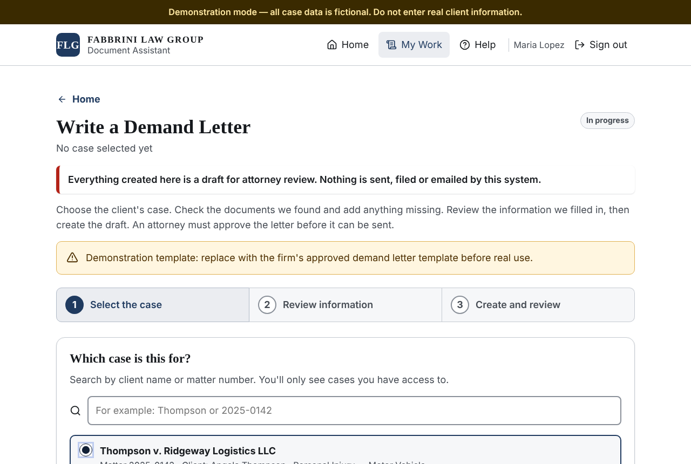
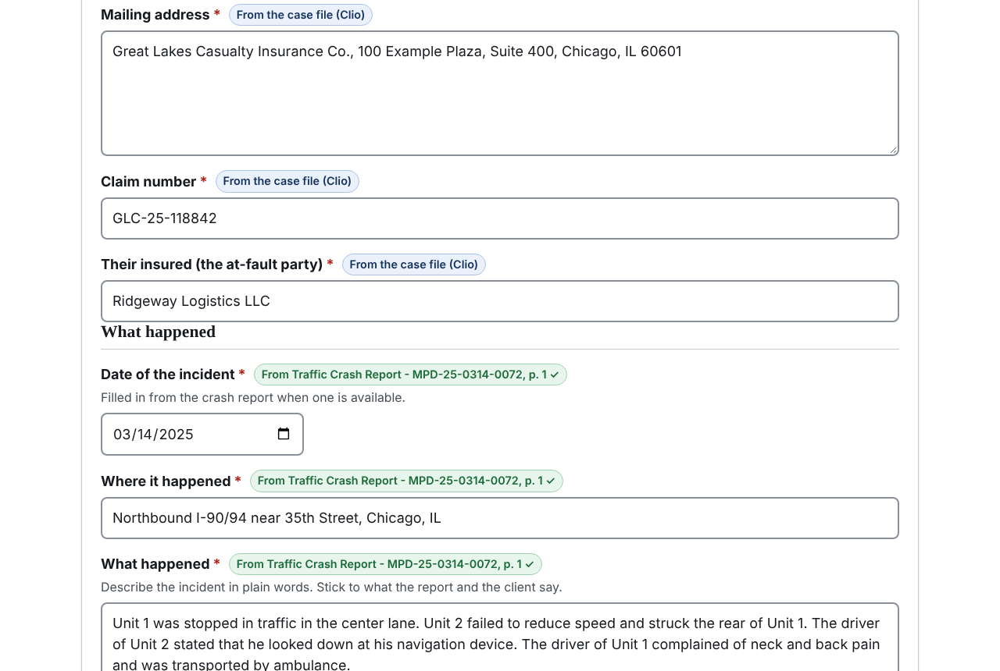
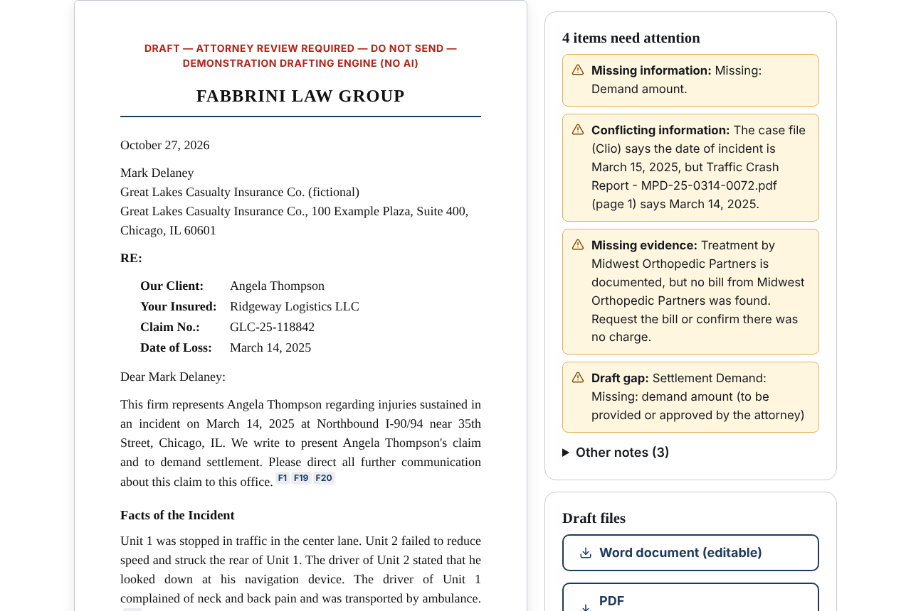
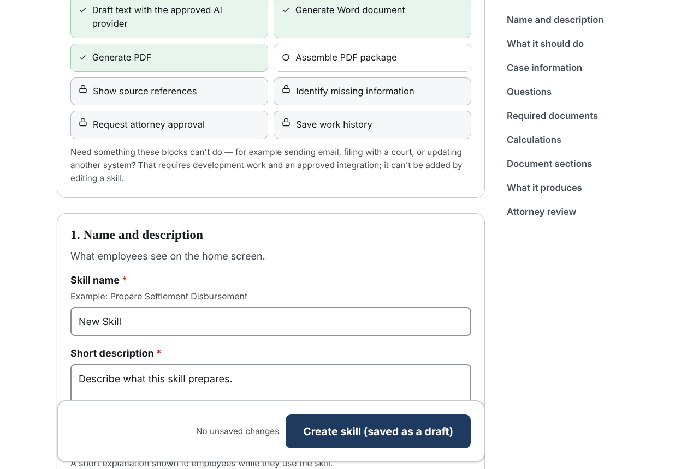
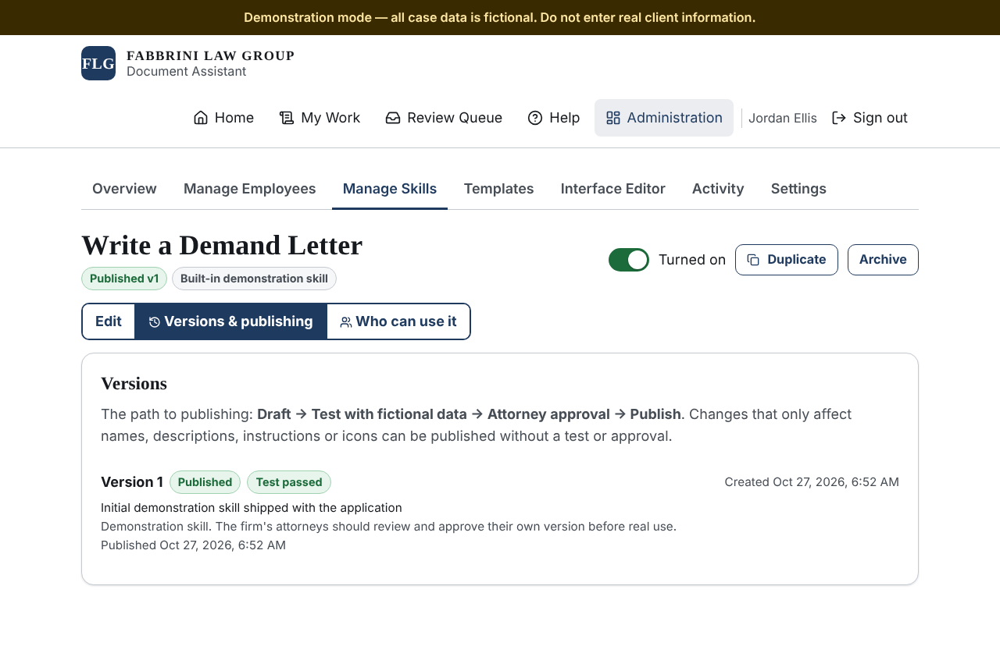
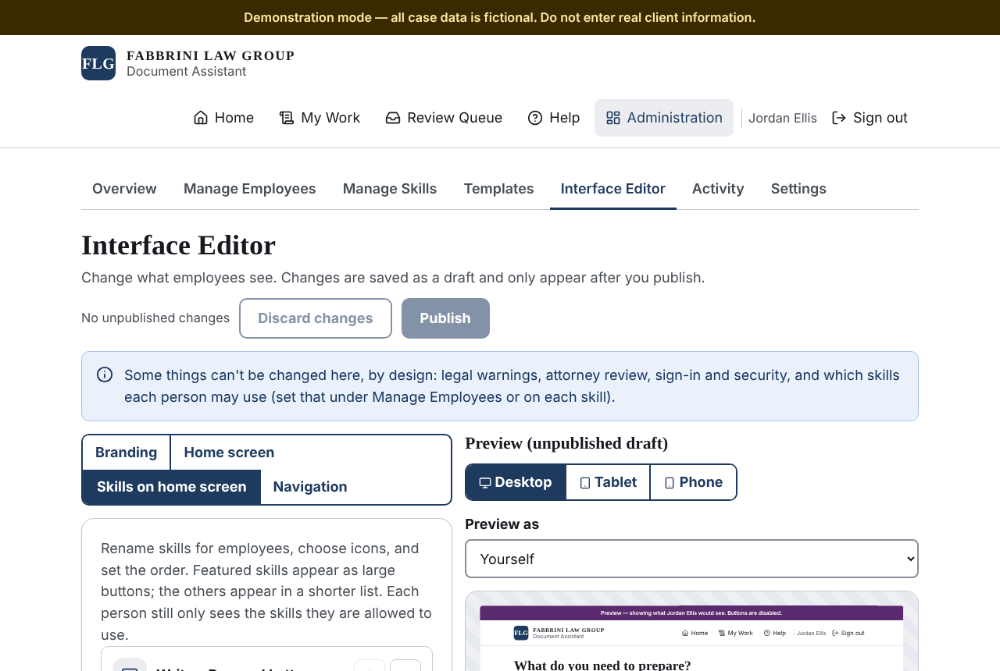
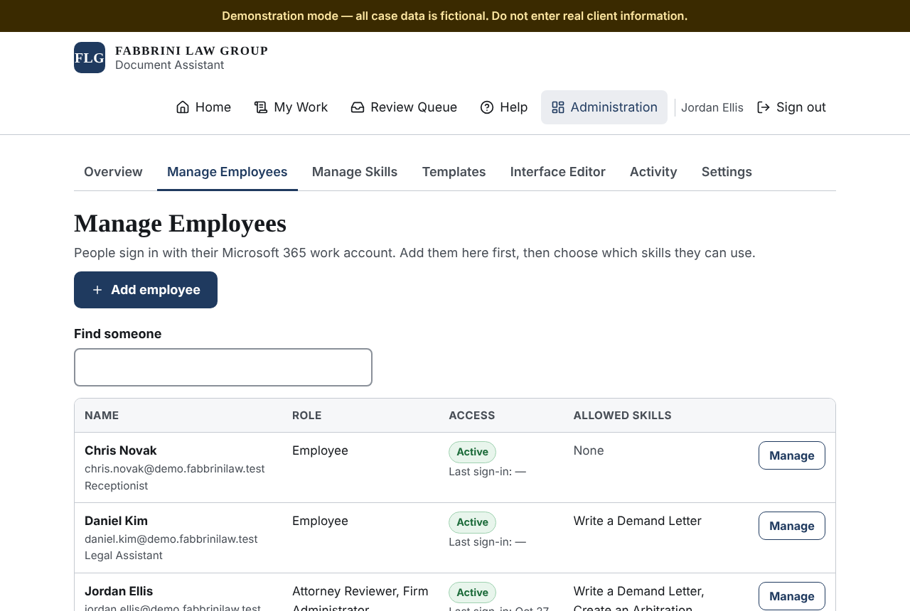

# Owner's guide

This guide shows how to run the Document Assistant day to day — no programming, ever. Every step
below was carried out by the automated browser tests on the real application (see
[TEST-RESULTS.md](TEST-RESULTS.md)); the button names here are the names on the screen.

While the app runs with fictional demonstration data, a dark banner across the top says
**"Demonstration mode — all case data is fictional."** Never type real client information while
that banner is showing.

## Who can do what

| Role | Can |
| --- | --- |
| **Employee** | Use the skills they've been given, on cases they can see in Clio. |
| **Attorney Reviewer** | Everything an employee can do, plus approve or return drafts, and approve skill changes. |
| **Firm Administrator** | Add and suspend employees, choose who gets each skill, build and publish skills, upload Word templates, change the home screen, read the activity log, pause all drafting. |
| **System Administrator** | Technical settings: AI provider, limits, retention, Clio field mapping. Only a System Administrator can make someone else a System Administrator. |

One person can hold several roles (for example, the managing attorney is usually Attorney Reviewer
and Firm Administrator).

All administration is under **Administration** in the top menu.

---

## What an employee sees

1. The employee signs in with their Microsoft 365 work account and sees only the tasks you gave them.

   

2. They click a task, then pick the case. They only see cases they can open in Clio.

   

3. They check the information. Each item shows where it came from — the case file, a page of a
   document, or "entered by you". They can upload extra documents here.

   

4. They click **Create the draft**. The draft appears with a list of anything that needs attention:
   missing information, missing evidence (for example a treatment with no bill), and conflicts
   (for example, Clio and the police report disagree on the accident date). The numbers next to
   sentences (F1, F2…) open the exact document page the fact came from.

   

5. They download the Word or PDF draft (marked DRAFT), and click **Send for attorney review**.
6. An attorney opens **Review Queue**, reads the draft and clicks **Approve** or **Request changes**
   (with comments). Once approved, the final files (without DRAFT markings) can be downloaded.

The system never sends, files or emails anything. A person always does that, after approval.

---

## Task A — Create a new skill

A "skill" is a task employees can choose on their home screen, like *Write a Demand Letter*.

1. **Administration → Manage Skills → Create New Skill.**
2. Type the **Skill name** and a **Short description** (what employees see on the card).
3. **Employee instructions** — a sentence or two telling staff what to have ready.
4. **Instructions** — in plain English, what the finished document should do. Example:
   *"Use the settlement amount and the contractual attorney fee to prepare a settlement
   disbursement statement. Calculate the client's net proceeds and flag missing information."*
5. **Questions** — click **Add a question** for each thing the employee must answer. Choose the
   **Type of answer** (text, dollar amount, number, date, yes/no, a list of choices, a table…),
   tick **Required** if it must be answered, and optionally a **Default answer**.
6. **Documents** — list the documents the employee should attach (for example medical bills) and
   whether each one is required. Missing required documents are flagged automatically.
7. **Calculations** — click **Add a calculation** for any arithmetic. Give it a **Name**, choose
   **What to do** (add, subtract, percentage of, total of a column…), and pick the values with
   **Add a value**. The software does the arithmetic exactly; AI is never used for numbers.
8. **Output** — choose Word, PDF, or both, and the Word template.
9. Click **Create skill (saved as a draft)**. Nobody can use it yet; it says **Not published yet**.

### Test it with fictional data

1. Open **Versions & publishing** and click **Test this version**.
2. The test opens like an employee would see it, using the fictional **Sample Test Matter** only.
   (Tests can never use a real case.) Answer the questions and click **Create the draft**.
3. Check the result. Example from the tests: settlement $100,000 at 33.33% shows a net to client
   of **$66,670.00**.
4. Click **Back to the skill**, then **Test passed** (or **Test failed** if something is wrong).

### Get attorney approval and publish

1. An Attorney Reviewer opens the same version and clicks **Approve as attorney**.
2. Click **Publish version 1**.

### Give it to an employee

1. Open **Who can use it** and switch it on next to the employee's name. It now says **Can use**.
2. The new card appears on that employee's home screen the next time their page loads.

---

## Task B — Change a skill and roll it back

1. **Manage Skills**, open the skill, and change the instructions or questions.
2. Type a short note in **Describe what you changed (optional)** and click **Save draft**. The
   published version keeps working for employees while you edit.
3. If the change affects what the document says (instructions, questions, calculations, sections,
   templates), the app tells you it **needs a test run and attorney approval** — follow the
   "Test it" and "approval" steps above, then **Publish version 2**.
   Changes that only affect names, descriptions, employee instructions, icons or categories can be
   published straight away.
4. To go back: **Versions & publishing → Restore this version** next to the older version, then
   **Restore and publish**. This creates a new version (for example version 3) that is a copy of the
   old one, so the history is never lost.

To stop employees using a skill without deleting it, switch it to **Turned off** (top right of the
skill). **Archive** hides it completely; **Duplicate** makes a copy to start a new skill from.

---

## Task C — Change the home screen

1. **Administration → Interface Editor.**
2. **Branding** — firm name, logo, colours, text size. Colour combinations that are hard to read
   are refused automatically.
3. **Home screen** — the **Welcome heading**, introductory text, recent work and help box.
4. **Skills on home screen** — rename a card (for example *Write a Demand Letter* → *Prepare
   Insurance Demand*), choose an **Icon**, put cards in categories, and use the up/down arrows to
   change the order.
5. **Preview** — choose phone, tablet or desktop, and use **Preview as** to see exactly what a
   particular employee would see. Your changes save as a draft automatically (**Draft saved**);
   employees don't see them yet.
6. Click **Publish**, then **Publish now**. Employees see the new layout the next time their page
   loads.
7. To undo: in the list of **Published versions**, click **Restore** next to an earlier version.

The editor only changes how things look. It cannot remove attorney review, change permissions, or
alter how documents are checked.

---

## Task D — Manage employees

### Add someone

1. **Administration → Manage Employees → Add employee.**
2. Enter their **Full name**, **Work email (Microsoft 365)**, **Job title** and **Role**, and
   choose the skills they can use.
3. They can now sign in with their Microsoft 365 account. People who are *not* added here cannot
   get in, even if they work at the firm.

### Turn a skill on or off for one person

Open the person (**Manage** next to their name) and switch skills on or off under **Skills this
person can use**. This takes effect on their next click.

### Suspend someone (for example, when they leave)

1. Open the person and click **Suspend access**.
2. Type a reason (it's kept in the activity log) and click **Suspend now**.
3. They are signed out everywhere **immediately**; any page they have open stops working, and they
   can't sign back in. **Restore access** undoes this.

In Microsoft 365 you should also disable their account as usual — the two are independent.

### Check what happened

**Administration → Activity** lists every sign-in, refusal, document created, approval, skill
change, interface change and suspension, with who did it and when. Type in **Search** to filter
(for example `user.suspended`). The log never contains document contents or passwords.

---

## Emergency stop

**Administration → Overview → Pause all document creation** stops all document reading and
drafting for everyone at once (saved work is kept). Employees see the reason you type. Click
**Resume document creation** to turn it back on. To stop just one skill, turn that skill off instead.

---

## Word templates

**Administration → Templates → Upload a Word template.** Design the letterhead in Word as usual,
and type `{{@body}}` on its own line where the drafted text should go. You can also use
placeholders such as `{{client_name}}`, `{{today}}` and `{{draft_banner}}`. The app lists the
placeholders it found and warns you if `{{@body}}` is missing. Then choose the template in the skill's
**Output** section (that is a significant change, so it needs a test and attorney approval).

The demand-letter and arbitration skills ship with a **demonstration** template and a
**demonstration** list of arbitration exhibit requirements. Replace both with the firm's approved
versions before real use.

---

## Settings (System Administrator)

**Administration → Settings** shows the system status (sign-in, database, storage, Clio, AI, PDF
creation, upload screening) and holds:

- **AI provider** — "Demonstration engine (no AI)" or Anthropic Claude, the model, a daily limit
  per person and a monthly budget. A real provider cannot be used until the **data-governance
  review** is completed: four confirmations about data retention, no training on the firm's data,
  a signed agreement, and a security review. See [AI-PROVIDER-SETUP.md](AI-PROVIDER-SETUP.md).
- **Attorney review** — whether an attorney may approve their own work (off by default).
- **Retention** — how many days uploaded working files and test runs are kept before automatic
  deletion (defaults 45 and 7 days). Approved final documents and the activity log are kept.
- **Clio custom fields** — which Clio custom field holds each piece of case information (for
  example the claim number). See [CLIO-SETUP.md](CLIO-SETUP.md).
